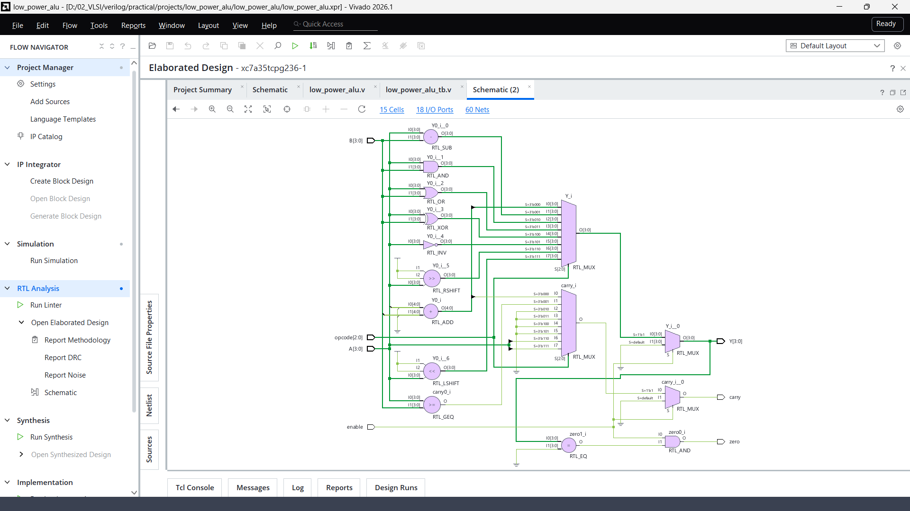
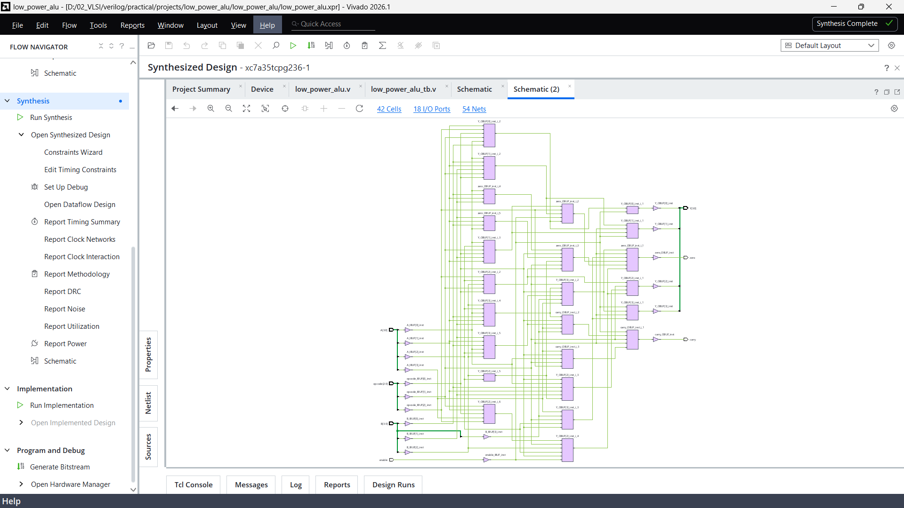
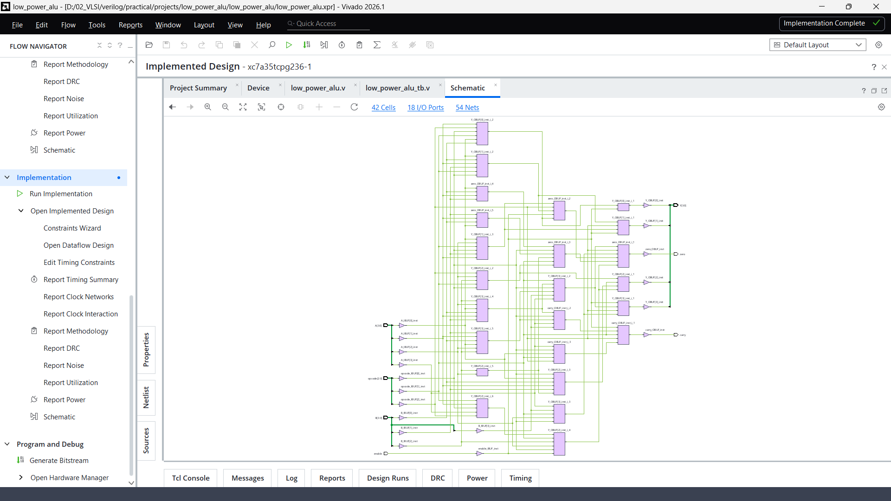
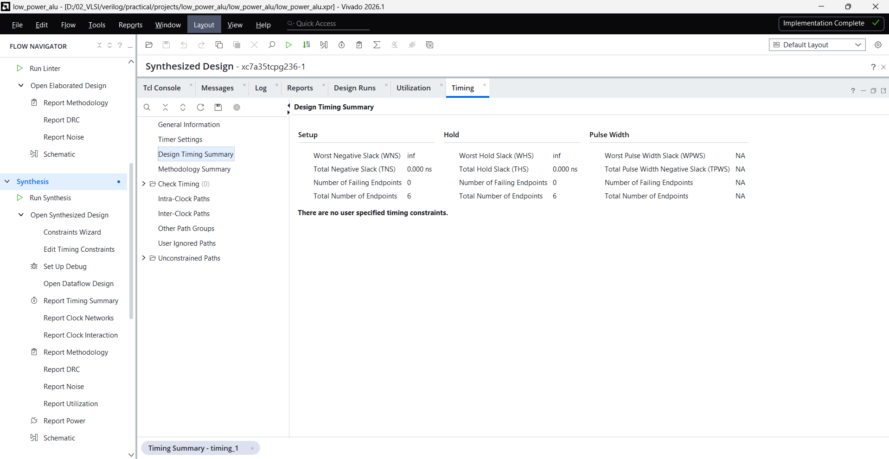
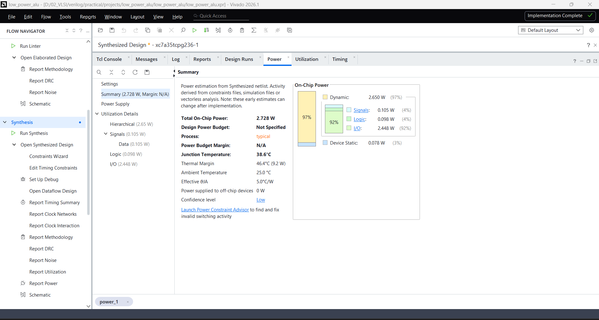
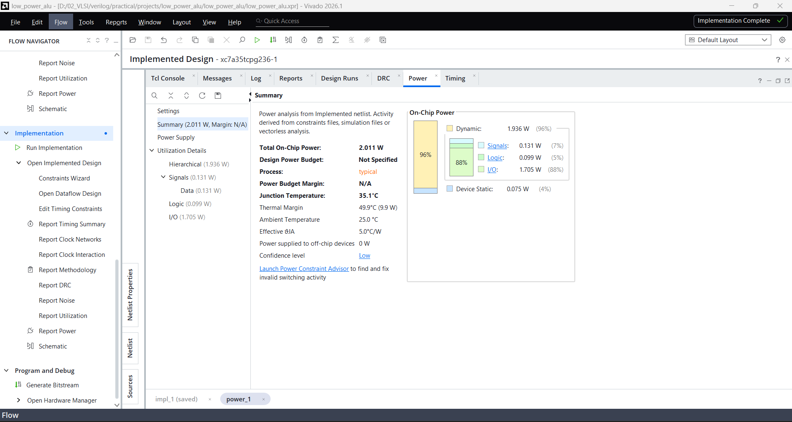

# Low-Power ALU Design Using VLSI Techniques

A 4-bit Arithmetic Logic Unit (ALU) designed using Verilog HDL, featuring eight arithmetic and logical operations, enable-based operation control, and FPGA hardware implementation using Xilinx Vivado.

---

## Overview

This project presents the RTL design, verification, synthesis, and FPGA hardware implementation of a **4-bit Arithmetic Logic Unit (ALU)** using Verilog HDL.

The ALU supports eight arithmetic, logical, and shift operations selected through a 3-bit opcode. An enable-based control mechanism is incorporated to keep the ALU outputs inactive when operation is not required, providing an RTL-level approach to reducing unnecessary combinational activity.

The design was functionally verified using a dedicated Verilog testbench, synthesized and implemented using Xilinx Vivado, and programmed onto a physical **Digilent Basys 3 FPGA development board**.

The project covers the digital hardware design flow, from RTL development to physical FPGA verification.

---

## Objectives

- Design a 4-bit ALU using Verilog HDL.
- Implement arithmetic, logical, and shift operations.
- Incorporate enable-based operation control.
- Develop a dedicated Verilog testbench.
- Verify the functionality of all eight operations.
- Perform RTL analysis and behavioral simulation.
- Analyze FPGA resource utilization and timing.
- Estimate power consumption using Xilinx Vivado.
- Generate FPGA bitstream and XDC constraint files.
- Implement and verify the design on physical FPGA hardware.

---

## ALU Specifications

| Parameter | Specification |
|---|---|
| ALU Width | 4-bit |
| Input A | 4-bit |
| Input B | 4-bit |
| Opcode | 3-bit |
| Enable | 1-bit |
| Output Y | 4-bit |
| Carry Flag | 1-bit |
| Zero Flag | 1-bit |
| Number of Operations | 8 |
| HDL | Verilog |
| Architecture | Combinational |
| FPGA Board | Digilent Basys 3 |
| FPGA Family | Xilinx Artix-7 |
| Design Tool | Xilinx Vivado |

---

## Supported Operations

| Opcode | Operation | Function |
|:---:|---|---|
| `000` | ADD | `A + B` |
| `001` | SUBTRACT | `A - B` |
| `010` | AND | `A & B` |
| `011` | OR | `A \| B` |
| `100` | XOR | `A ^ B` |
| `101` | NOT | `~A` |
| `110` | RIGHT SHIFT | `A >> 1` |
| `111` | LEFT SHIFT | `A << 1` |

---

## Low-Power Design Approach

The design uses an **enable-based operation control technique**.

- When `enable = 1`, the selected ALU operation is performed.
- When `enable = 0`, the ALU output and flags are driven to their inactive values.

This approach is intended to reduce unnecessary combinational activity when the ALU is inactive.

> **Power analysis note:** Vivado power reports are tool-based estimates with low confidence. They are not direct physical power measurements, and the comparison between synthesis and implementation estimates does not independently establish the power savings caused by the enable mechanism.

---

## Architecture

The ALU receives two 4-bit operands, a 3-bit opcode, and an enable signal. The combinational logic performs the selected operation and generates the result, carry flag, and zero flag.

```text
              +------------------------+
              |                        |
 A[3:0] ----->|                        |-----> Y[3:0]
              |                        |
 B[3:0] ----->|     LOW-POWER          |-----> Carry
              |       4-BIT ALU        |
Opcode[2:0] ->|                        |-----> Zero
              |                        |
 Enable ----->|                        |
              +------------------------+
```

---

## Project Structure

```text
Low-Power-ALU-Design-Using-VLSI-Techniques/
│
├── RTL/
│   └── low_power_alu.v
│
├── Testbench/
│   └── low_power_alu_tb.v
│
├── Constraints/
│   └── LowPowerALU.xdc
│
├── Bitstream/
│   └── low_power_alu.bit
│
├── Simulation/
│
├── Synthesis/
│   └── Reports/
│       ├── Timing Analysis.txt
│       ├── low_power_alu_numerical_report.txt
│       └── utilization_report.txt
│
├── Documentation/
│   ├── RTL_Analysis.png
│   ├── Simulation.png
│   ├── Synthesis.png
│   ├── Implementation.png
│   ├── pre_implementation_power.png
│   ├── post_implementation_power.png
│   ├── timing_summary.png
│   ├── utilization_summary.png
│   ├── FPGA_Hardware_Implementation_1.jpeg
│   └── FPGA_Hardware_Implementation_2.jpeg
│
├── Results/
│   ├── expected_results_table.png
│   └── final_results.md
│
├── README.md
├── LICENSE
└── .gitignore
```

---

## Functional Verification

A dedicated Verilog testbench was developed to verify the ALU's supported operations, zero-flag behavior, and enable control.

### Verification Test Cases

| Operation | Test Input | Expected Output |
|---|---|---|
| ADD | `0101 + 0011` | `1000` |
| SUBTRACT | `1001 - 0011` | `0110` |
| AND | `1100 & 1010` | `1000` |
| OR | `1100 \| 1010` | `1110` |
| XOR | `1100 ^ 1010` | `0110` |
| NOT | `~1010` | `0101` |
| RIGHT SHIFT | `1011 >> 1` | `0101` |
| LEFT SHIFT | `1011 << 1` | `0110` |

Additional tests verify zero-flag behavior and disabled operation.

**Functional verification: 8/8 ALU operations passed.**

---

## RTL Analysis

The Verilog RTL describes the combinational ALU logic and its output control.



---

## Behavioral Simulation

Behavioral simulation was performed using Xilinx Vivado Simulator to verify the ALU functionality.


---

## Synthesis and Implementation

The design was synthesized and implemented using Xilinx Vivado for the Artix-7 FPGA device.

**Target device:** `xc7a35tcpg236-1`





---

## FPGA Resource Utilization

| Resource | Used | Available | Utilization |
|---|---:|---:|---:|
| LUT | 20 | 20,800 | 0.10% |
| I/O | 18 | 106 | 16.98% |
| Flip-Flops | 0 | — | 0% |

The design is combinational and does not require sequential flip-flops.


---

## Timing Analysis

No user-defined timing constraints were specified for the reported implementation analysis.

| Timing Parameter | Result |
|---|---:|
| WNS | `inf` |
| TNS | `0.000 ns` |
| WHS | `inf` |
| THS | `0.000 ns` |
| Failing Endpoints | 0 |
| Total Endpoints | 6 |

> The `inf` WNS/WHS values are not interpreted as actual timing margins because no user-defined timing constraints were specified. Zero failing endpoints in this unconstrained analysis does not establish that the design meets a particular clock-frequency target.



---

## Power Analysis

Power estimation was performed using Xilinx Vivado.

### Pre-Implementation Power Estimate

| Power Component | Value |
|---|---:|
| Total On-Chip Power | 2.728 W |
| Dynamic Power | 2.650 W |
| Static Power | 0.078 W |
| Logic Power | 0.098 W |
| Signal Power | 0.105 W |
| I/O Power | 2.448 W |
| Junction Temperature | 38.6°C |
| Confidence | Low |



### Post-Implementation Power Estimate

| Power Component | Value |
|---|---:|
| Total On-Chip Power | 2.011 W |
| Dynamic Power | 1.936 W |
| Static Power | 0.075 W |
| Logic Power | 0.099 W |
| Signal Power | 0.131 W |
| I/O Power | 1.705 W |
| Junction Temperature | 35.1°C |
| Thermal Margin | 49.9°C |
| Confidence | Low |



### Estimated Power Comparison

| Parameter | Pre-Implementation | Post-Implementation | Difference |
|---|---:|---:|---:|
| Total Power | 2.728 W | 2.011 W | 26.28% lower |
| Dynamic Power | 2.650 W | 1.936 W | 26.94% lower |
| I/O Power | 2.448 W | 1.705 W | 30.39% lower |

These figures compare the two Vivado estimates. They should not be interpreted as measured physical power savings.

---

## FPGA Hardware Implementation

The ALU was programmed onto a **Digilent Basys 3 FPGA development board** using the generated bitstream.

The physical implementation was tested, and all eight supported ALU operations were verified successfully.

### Hardware Setup


*Figure 1: Low-Power ALU implementation on the Digilent Basys 3 FPGA development board.*


*Figure 2: Alternate view of the programmed FPGA hardware setup.*

### Hardware Verification

The physical FPGA testing covered:

- Addition
- Subtraction
- Bitwise AND
- Bitwise OR
- Bitwise XOR
- Bitwise NOT
- Right Shift
- Left Shift

**Hardware verification result: All eight ALU operations were tested successfully on the physical FPGA board.**

---

## FPGA Constraints and Bitstream

The repository includes the generated implementation files.

| File | Purpose |
|---|---|
| `Constraints/LowPowerALU.xdc` | Defines FPGA pin assignments and applicable I/O constraints |
| `Bitstream/low_power_alu.bit` | Generated FPGA configuration bitstream |

The XDC file defines the physical FPGA pin assignments used by the implementation. The bitstream can be used to configure the target FPGA when paired with the appropriate board and programming workflow.

**Note:** Review the XDC file before reusing the design to ensure its pin assignments match the target board and the actual RTL port names.

---

## Key Results

| Metric | Result |
|---|---:|
| ALU Width | 4-bit |
| Supported Operations | 8 |
| Functional Verification | 8/8 Passed |
| Physical FPGA Verification | Successful |
| LUTs Used | 20 |
| LUT Utilization | 0.10% |
| I/O Used | 18 |
| Post-Implementation Estimated Power | 2.011 W |
| Bitstream Generated | Yes |
| XDC Constraints Generated | Yes |

---

## Tools and Technologies

- **HDL:** Verilog
- **RTL Simulation:** Xilinx Vivado Simulator
- **Synthesis and Implementation:** Xilinx Vivado
- **FPGA Family:** Xilinx Artix-7
- **FPGA Board:** Digilent Basys 3
- **Version Control:** Git and GitHub

---

## Future Scope

- Further optimization of combinational switching activity.
- Hardware-based power measurement.
- Operand isolation and additional low-power techniques.
- Expansion to 8-bit and 16-bit ALU architectures.
- Additional arithmetic and logical operations.
- Pipelined ALU architecture.
- ASIC-oriented synthesis and power analysis.

---

## Author

**Ruturaj Vyavahare**

Electronics & Telecommunication Engineering  
PVG's College of Engineering, Technology and Management, Pune

GitHub: [RuturajVyavahare](https://github.com/RuturajVyavahare)

**Project Repository:** [Low-Power ALU Design Using VLSI Techniques](https://github.com/RuturajVyavahare/Low-Power-ALU-Design-Using-VLSI-Techniques)

---

## License

This project is licensed under the MIT License. See the `LICENSE` file for details.
