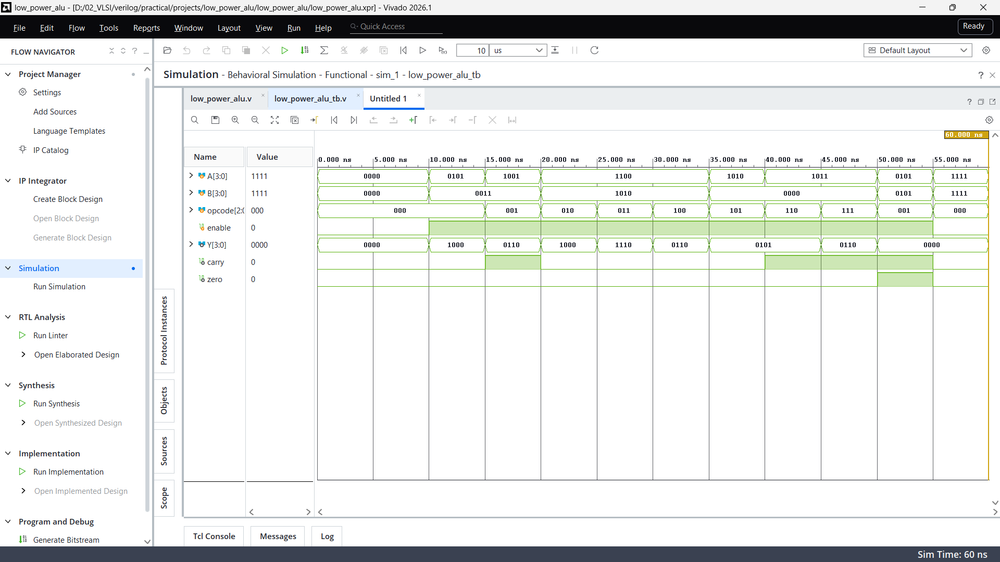
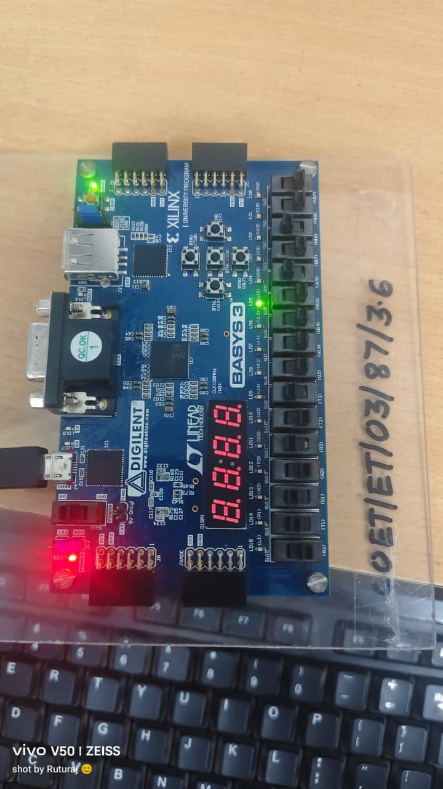
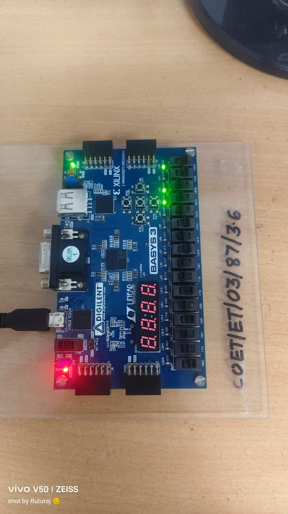
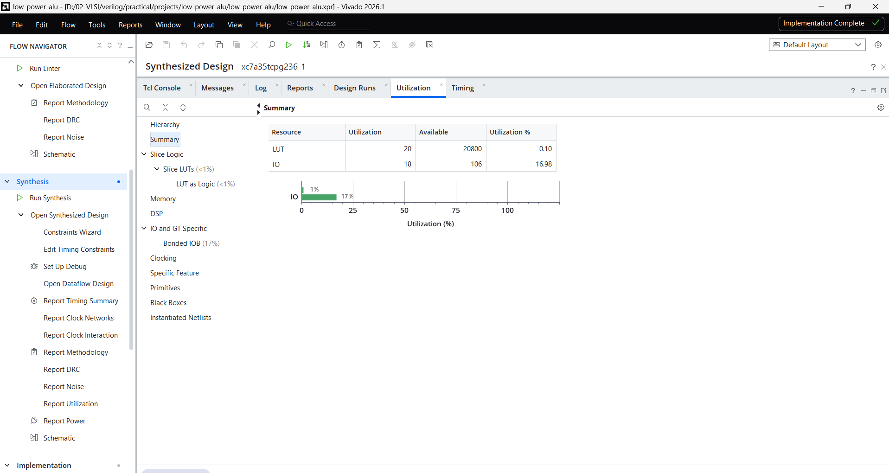

# Low-Power ALU Design Using VLSI Techniques

A **4-bit Arithmetic Logic Unit (ALU)** designed using Verilog HDL, simulated and implemented on a **Digilent Basys 3 FPGA board** using AMD Xilinx Vivado.

The project implements eight arithmetic and logical operations, with enable-based operation control and status flags for carry and zero.

## Project Overview

The ALU accepts two 4-bit operands and a 3-bit opcode to select one of eight operations. An enable input controls whether the selected operation is performed.

**Key features**
- Eight arithmetic, logical, and shift operations
- Enable-based operation control
- Carry and zero status flags
- Verilog RTL design and testbench verification
- FPGA synthesis, implementation, and bitstream generation
- Physical testing on a Digilent Basys 3 FPGA board

## ALU Block Diagram


The diagram illustrates the main ALU inputs, operation selection, functional units, result output, and status flags. It is a conceptual representation of the RTL design.

## ALU Specifications

| Parameter | Description |
|---|---|
| Design | 4-bit ALU |
| HDL | Verilog |
| Operand inputs | `A[3:0]`, `B[3:0]` |
| Operation selector | `opcode[2:0]` |
| Control input | `enable` |
| Result output | `Y[3:0]` |
| Status outputs | `carry`, `zero` |
| FPGA board | Digilent Basys 3 |
| FPGA device | Artix-7 `xc7a35tcpg236-1` |
| Design tool | AMD Xilinx Vivado |

## Supported Operations

| Opcode | Operation | Function |
|---|---|---|
| `000` | Addition | `Y = A + B` |
| `001` | Subtraction | `Y = A - B` |
| `010` | Bitwise AND | `Y = A & B` |
| `011` | Bitwise OR | `Y = A \| B` |
| `100` | Bitwise XOR | `Y = A ^ B` |
| `101` | Bitwise NOT | `Y = ~A` |
| `110` | Right Shift | `Y = A >> 1` |
| `111` | Left Shift | `Y = A << 1` |

### Status Flags

- **Carry:** For addition, indicates an unsigned carry-out. For subtraction, it is high when `A >= B`, indicating no borrow. For shifts, it captures the bit shifted out of operand A.
- **Zero:** High when the ALU is enabled and the result `Y` equals zero.
- **Enable:** When low, the result and carry are set to zero, and the zero flag is deasserted.

## Low-Power Design Approach

The design uses enable-based operation control. When `enable` is low, the RTL assigns default output values instead of selecting an ALU operation.

This approach is intended to reduce unnecessary combinational activity while the ALU is inactive. Actual power savings depend on synthesis, implementation, input activity, and the FPGA device. Vivado power estimates should not be interpreted as direct measurements of physical power consumption.

## Simulation and Verification

The design was tested using a Verilog testbench in Vivado behavioral simulation.

The testbench exercises the supported opcodes and checks the ALU output and status flags for the applied input combinations.



Simulation verifies the RTL's behavior before FPGA implementation. The waveform should be reviewed alongside the testbench to confirm the individual operation results.

## FPGA Hardware Implementation

The synthesized design was implemented on a **Digilent Basys 3 FPGA development board**.

The generated bitstream was programmed onto the board, and the supported ALU operations were tested using the configured physical inputs and outputs.

### Hardware Photograph 1



### Hardware Photograph 2



## FPGA Resource Utilization

Vivado reported the following resource utilization for the implemented design:

| Resource | Used | Available | Utilization |
|---|---:|---:|---:|
| LUT | 20 | 20,800 | 0.10% |
| I/O | 18 | 106 | 16.98% |



These figures describe the reported resource utilization for this implementation. The I/O percentage reflects the number of used I/O resources relative to the device's available I/O resources.

## Tools and Technologies

- Verilog HDL
- AMD Xilinx Vivado
- Digilent Basys 3 FPGA board
- Behavioral simulation and testbench verification
- FPGA synthesis and implementation

## Repository Structure

```text
Low-Power-ALU-Design-Using-VLSI-Techniques/
├── RTL/
│   └── low_power_alu.v
├── Testbench/
│   └── low_power_alu_tb.v
├── Constraints/
│   └── LowPowerALU.xdc
├── Bitstream/
│   └── low_power_alu.bit
├── Documentation/
│   ├── Simulation.png
│   ├── utilization_summary.png
│   ├── FPGA_Hardware_Implementation_1.jpeg
│   ├── FPGA_Hardware_Implementation_2.jpeg
│   ├── Implementation.png
│   ├── RTL_Analysis.png
│   ├── Synthesis.png
│   ├── pre_implementation_power.png
│   ├── post_implementation_power.png
│   └── timing_summary.png
├── Results/
│   ├── block diagram.png
│   └── final_results.md
├── Synthesis/
│   └── Reports/
└── README.md
```

*The paths above assume the listed screenshots are stored in the `Documentation` folder. Adjust the image references if your actual filenames or locations differ.*

## Learning Outcomes

Through this project, I gained practical experience in:

- Designing combinational digital circuits using Verilog HDL
- Implementing arithmetic and logical operations in an ALU
- Developing and running a functional simulation testbench
- Understanding synthesis and FPGA resource utilization
- Generating and programming an FPGA bitstream
- Verifying digital logic on physical FPGA hardware

## Future Improvements

- Evaluate power consumption using controlled switching-activity data and suitable measurement methods.
- Add timing constraints and evaluate timing performance.
- Explore further RTL optimizations and compare synthesis results.

## Author

**Ruturaj Vyavahare**

Electronics and Telecommunication Engineering  
Interested in VLSI Design, RTL Design, FPGA Development, and Digital Verification.

## GitHub Repository

[Low-Power ALU Design Using VLSI Techniques](https://github.com/RuturajVyavahare/Low-Power-ALU-Design-Using-VLSI-Techniques)

Feedback and suggestions are welcome.

## License

This project is distributed under the license provided in the repository. Please refer to the `LICENSE` file for details.